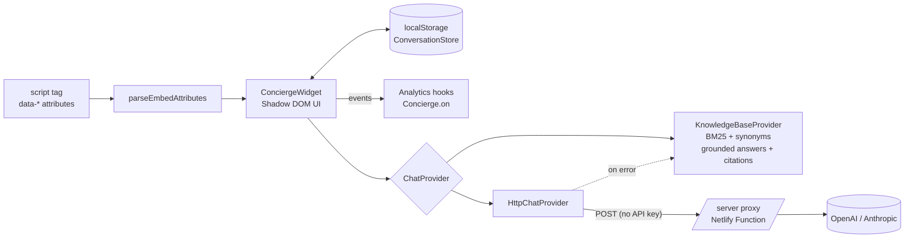

# Concierge: Embeddable AI Support Chat Widget

Concierge is a framework-free TypeScript chat widget that small businesses add to any website with **one script tag**. By default it answers from the business's own FAQ using an offline retrieval engine, so it needs no API key and costs nothing to run. When it isn't confident, it says so and hands the visitor over to a human. An LLM backend can be switched on through a small server proxy.

> **Demo project.** "Brightsmile Dental" is a fictional clinic.
> **Live demo:** https://rafaelcarvalho.dev/chat-widget/ (clinic page) · `playground.html` (configurator)

## Embed it

```html
<script
  src="https://cdn.example.com/concierge.js"
  data-business-id="brightsmile"
  data-business-name="Brightsmile Dental"
  data-color="#0e7490"
  data-position="right"
  data-language="en"
  data-greeting="Hi! Ask me anything about our clinic."
  data-kb-url="/kb/brightsmile.json"
  data-handoff-email="hello@brightsmile.example"
  data-handoff-whatsapp="15550100100"
  data-quick-replies="Opening hours|Prices|Do you accept insurance?"
  defer
></script>
```

| Attribute                                      | Default          | Notes                                                                         |
| ---------------------------------------------- | ---------------- | ----------------------------------------------------------------------------- |
| `data-business-id`                             | `demo`           | Namespaces the stored conversation (sanitized)                                |
| `data-business-name`                           | `our team`       | Used in the greeting and header                                               |
| `data-color`                                   | `#0f766e`        | Hex colour; the text colour on top of it is picked automatically for contrast |
| `data-position`                                | `right`          | `right` or `left`                                                             |
| `data-language`                                | browser language | `en`, `pt` or `es`; anything else falls back to English                       |
| `data-greeting`                                | localized        | Custom first message                                                          |
| `data-kb-url`                                  | none             | Knowledge base JSON (format below)                                            |
| `data-threshold`                               | `0.35`           | Confidence (0 to 1) below which the bot hands off instead of answering        |
| `data-quick-replies`                           | none             | Up to 4 suggestions, separated by `\|`                                        |
| `data-handoff-email` / `data-handoff-whatsapp` | none             | Enables the "Talk to a human" form and direct links                           |
| `data-provider` + `data-endpoint`              | `kb`             | `http` turns on the LLM proxy provider                                        |
| `data-auto-open`                               | `false`          | Opens the chat on the first visit                                             |
| `data-manual`                                  | none             | Don't auto-start; call `Concierge.init({...})` yourself                       |

### JavaScript API and analytics hooks

```js
Concierge.open();
Concierge.close();
Concierge.on((event) => {
  // { type: 'open' | 'close' | 'message' | 'answer' | 'unanswered' | 'handoff', ... }
  if (event.type === 'unanswered') gtag('event', 'chat_unanswered', { question: event.question });
});
```

The **unanswered** events list the questions your FAQ doesn't cover yet. The playground collects them into a to-do list for site owners.

## Features

- **One file, about 11 KB gzipped, no dependencies.** It is an IIFE bundle built with Vite library mode, and `npm run size` checks it against a 30 KB budget.
- **Shadow DOM isolation.** The host site's CSS can't break the widget, and the widget's CSS can't affect the site.
- **Accessible:**
  - the launcher has `aria-expanded` and an unread count in its label;
  - the panel is a labelled dialog with a **focus trap**; Escape closes it and returns focus to the launcher;
  - messages sit in a `role="log"` **aria-live** region and the typing indicator is announced;
  - everything works from the keyboard, with visible focus rings and support for reduced motion.
- **Mobile.** Below 480 px the chat goes **full-screen**.
- **Persistence.** The conversation and unread count are stored in `localStorage` per business. Entries are versioned, capped at 60 messages and expire after 7 days. If storage is blocked or the data is corrupted, the widget starts a fresh conversation instead of breaking.
- **Chat details:** typing indicator, quick-reply chips, **unread badge**, a "start over" button, and cited sources under each answer.
- **Human handoff.** A contact form (validated name and email) plus mailto and WhatsApp deep links, pre-filled with the visitor's last question.
- **Interface languages:** English, Portuguese and Spanish (every key is checked by a test).
- **Safe rendering.** All text goes through `textContent`, and source links only allow `http(s)`, `mailto` and relative URLs.

## Architecture



```
src/
  core/        types, config parsing, i18n (en/pt/es), storage, event emitter
  brain/       text.ts (folding, stop words, stemming), bm25.ts, knowledgeBase.ts, httpProvider.ts
  widget/      Widget.ts (UI + a11y), styles.ts, dom.ts, createProvider.ts
  embed.ts     script-tag entry + window.Concierge API
  playground/  configurator page logic
server/netlify/functions/chat.ts   example LLM proxy (not deployed)
public/kb/brightsmile.json         demo knowledge base
```

### How the offline "brain" decides

1. **Index.** Each entry's question and tags (repeated 3 times to weight them) plus its answer are indexed with **BM25** (k1 = 1.4, b = 0.6). Text is lowercased, accents are removed, stop words in English, Portuguese and Spanish are dropped, and plurals are stemmed lightly.
2. **Expand.** Query terms are expanded with the knowledge base's **synonym groups**, with expansions weighted at 0.8. Because those groups also contain Portuguese and Spanish words, "Quanto custa o clareamento?" finds the English whitening-price entry.
3. **Rank and measure confidence.** The top BM25 result is the candidate answer. Confidence measures how much of the question that entry actually covers: the idf-weighted share of the question's terms (or their synonyms) found in the entry.
4. **Answer or hand off.** Below the threshold, the bot does **not guess**. It replies "I'm not sure, want to talk to our team?" and emits an `unanswered` event. Otherwise it returns the entry's answer **verbatim**, with a source citation, so it can't make anything up.

### LLM mode, with no keys in the browser

`HttpChatProvider` posts `{ businessId, language, messages, context }` to **your** server proxy. The `context` holds the top knowledge-base passages, so the model stays grounded in the business's own content.

- **Responses.** It accepts the proxy's own `{ reply, sources }` shape, as well as raw OpenAI and Anthropic response shapes.
- **Fallback.** On a timeout, an HTTP error or malformed output, it falls back to the offline knowledge-base answer.

`server/netlify/functions/chat.ts` is a complete example proxy:

- origin allow-list (CORS);
- per-IP rate limiting;
- input caps;
- a system prompt that tells the model to answer only from the provided sources;
- OpenAI or Anthropic selected through environment variables.

It is not deployed, and no key ships with this repository.

## Knowledge base format

```json
{
  "business": "Brightsmile Dental",
  "synonyms": { "price": ["cost", "fee", "preco", "precio"] },
  "entries": [
    {
      "id": "hours",
      "question": "What are your opening hours?",
      "answer": "Mon-Fri 8:00-19:00...",
      "tags": ["open", "weekend"],
      "url": "/#hours"
    }
  ]
}
```

## Develop

```bash
npm install
npm run dev        # http://localhost:5173/playground.html (the landing page needs the built widget)
npm test           # Vitest (33 tests)
npm run lint
npm run build      # dist/: index.html + playground.html + concierge.js + kb/
npm run size       # gzip budget check
```

The tests cover:

- **Retrieval ranking**: 8 English intents and 4 Portuguese/Spanish questions resolved through synonyms.
- **Thresholds**: the "I don't know" fallback and how a stricter threshold changes the result.
- **BM25 internals**: ranking and idf.
- **HTTP provider**: no Authorization header, grounding context, OpenAI and Anthropic response shapes, fallback.
- **i18n**: every key present in all three languages.
- **Embed attribute parsing**: valid input and invalid or hostile values.
- **Persistence**: message cap, expiry, corrupted or unavailable storage.
- **Widget DOM**: Shadow DOM isolation, answers with citations, handoff form validation, quick replies, unread badge, focus trap and Escape, persistence across page loads, XSS-safe rendering, localization.

## Limitations

- Retrieval is lexical (BM25), not semantic. Synonym groups cover the common paraphrases; very different wordings may need an extra tag or the LLM mode.
- The knowledge base is written in one language (English in the demo). Portuguese and Spanish questions match through synonyms, but answers come back in the knowledge base's language.
- The handoff form only emits an event in this demo. Wire it to your CRM, email service or helpdesk through `Concierge.on`.

---

Built by [Rafael Carvalho](https://rafaelcarvalho.dev).
